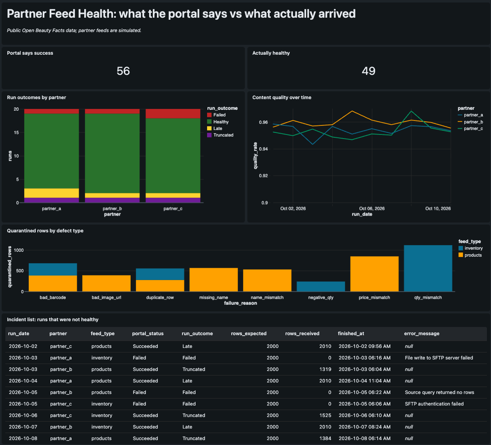
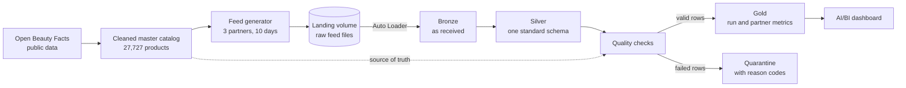

# Partner Feed Lakehouse

A Databricks lakehouse prototype that ingests, validates, and monitors simulated outbound partner feeds. It answers four questions about every daily delivery: did it go out, was it on time, was it complete, and was the content correct?

Built on public product data from [Open Beauty Facts](https://world.openbeautyfacts.org/). The partners, feeds, prices, inventory, and incidents are all simulated. No proprietary data is used.



## Why this project

A delivery status of "succeeded" only says that a job ran and a file was sent. It cannot tell you that the file arrived late, was missing a third of its rows, or contained wrong prices. This project builds both views side by side: the run status a scheduler would report, and the actual health of what was delivered.

In the simulated data, 56 of 60 scheduled deliveries report success, but only 49 are healthy.

## Architecture



## The data

| Step | Result |
|---|---|
| Raw Open Beauty Facts export | 64,237 products, 200 columns |
| After keeping 8 catalog fields and dropping rows missing a code, name, brand, or image | 27,741 |
| After keeping valid barcode lengths (8, 12, 13, 14) and removing duplicates | 27,727 |

Barcodes are read as text throughout, because reading them as numbers silently drops leading zeros.

Open Beauty Facts has no prices or inventory, so both are generated.

## What is simulated

Three fictional partners each receive a **products** feed and an **inventory** feed every day for 10 days, which makes 60 scheduled runs. Each partner gets a different format and a different subset of fields.

| Partner | Products feed | Inventory feed |
|---|---|---|
| A | XML on days 1 to 5, then JSON on days 6 to 10 (a mid-stream format migration with a nested price object) | CSV |
| B | CSV | CSV |
| C | JSON lines | JSON lines |

The generator plants problems on a fixed schedule so the results are repeatable:

| Planted problem | Count |
|---|---|
| Failed runs (no file sent, with an error message) | 4 |
| Late runs (finished after the 08:00 UTC deadline) | 4 |
| Truncated files (fewer rows than expected) | 3 |
| Row-level defects: missing name, bad barcode, bad image URL, price or name that differs from the master, quantity that differs from the master, negative quantity, duplicate rows | 4,938 rows (broken down in the scorecard below) |

The generator also writes an answer key, so the quality checks can be graded against what was actually planted.

## Pipeline layers

| Layer | What it does | Notebook |
|---|---|---|
| Bronze | Auto Loader ingests every file exactly as received. All columns stay as strings, and each row records its source file and ingest time. Files are loaded in two waves, and the second wave processes only new files. | `01_bronze_ingest` |
| Silver | Translates three formats and several field-name styles into one schema. Types are parsed with `try_cast` and `try_to_timestamp`, so a bad value becomes null and nothing is dropped. | `02_silver_standardize` |
| Quality | Checks each row against rules and against the master catalog. Failing rows go to a quarantine table with a reason code. | `03_quality_checks` |
| Gold | Run-level health (failed, late, truncated, healthy) and daily per-partner metrics. | `04_gold_metrics` |

Details worth noting:
- Partner A's XML and JSON files land in the same folder, so they are ingested into two separate bronze tables with file-pattern filters and combined in silver.
- No rows are lost between bronze and silver: 54,963 product rows and 55,795 inventory rows in, and the same out.

## Results

### Row-level checks against the answer key

| Defect | Planted | Flagged | Recall | Precision |
|---|---|---|---|---|
| qty_mismatch | 1,119 | 1,119 | 1.000 | 1.000 |
| price_mismatch | 848 | 848 | 1.000 | 1.000 |
| bad_barcode | 688 | 681 | 0.990 | 1.000 |
| missing_name | 567 | 567 | 1.000 | 1.000 |
| duplicate_row | 549 | 556 | 1.000 | 0.987 |
| name_mismatch | 538 | 531 | 0.987 | 1.000 |
| bad_image_url | 390 | 390 | 1.000 | 1.000 |
| negative_qty | 239 | 239 | 1.000 | 1.000 |

4,924 of the 4,938 planted row-level defects were caught, about 99.7%. Fourteen were missed: 7 bad barcodes and 7 name mismatches. I have not yet traced why.

### Run-level health

All 11 planted delivery incidents were detected: 4 failed, 4 late, and 3 truncated runs. A run is counted as late if it finished after 08:00 UTC, and as truncated if it delivered fewer than 95% of the expected rows.

| Outcome | Runs |
|---|---|
| Healthy | 49 |
| Late | 4 |
| Failed | 4 |
| Truncated | 3 |

The 7 late and truncated runs all report a status of "Succeeded". A view based only on run status would miss them.

## Dashboard

The dashboard has two headline counters (runs reporting success versus runs actually healthy), run outcomes by partner, content quality over time, quarantined rows by defect type, and a list of every run that was not healthy. The dataset queries behind it are in `sql/dashboard_datasets.sql`.

## Limitations

- The partners, feeds, incidents, prices, and inventory are simulated, and the incident schedule is fixed. The detection numbers measure the checks against planted problems, not against real-world data.
- The 10-day window and about 55,000 rows per feed type are small. Nothing here was tested at production scale.
- Open Beauty Facts is crowdsourced and messy, and its products are not all cosmetics. That is useful for testing validation, but it is not a clean catalog.
- The rules compare against a master catalog that is, by construction, correct.
- Built on Databricks Free Edition, which has usage limits and serverless compute only.

## Repo layout

```
data_generation/   Scripts to explore, clean, and generate the data
notebooks/         Databricks notebooks for bronze, silver, quality, and gold
sql/               Dashboard dataset queries
docs/              Dashboard screenshot
```

## Reproducing it

1. Create a Databricks Free Edition workspace and a catalog named `partner_feeds` with `bronze`, `silver`, and `gold` schemas.
2. Download the Open Beauty Facts cosmetics CSV, then run `data_generation/clean_base_data.py` and `data_generation/generate_outbound_feeds.py`.
3. Upload the master files, delivery log, and answer key to a volume, and the feed files to the landing volume.
4. Run the notebooks in order, then build the dashboard from `sql/dashboard_datasets.sql`.

## Data attribution

Product data comes from [Open Beauty Facts](https://world.openbeautyfacts.org/), made available under the [Open Database License](https://opendatacommons.org/licenses/odbl/1-0/).
